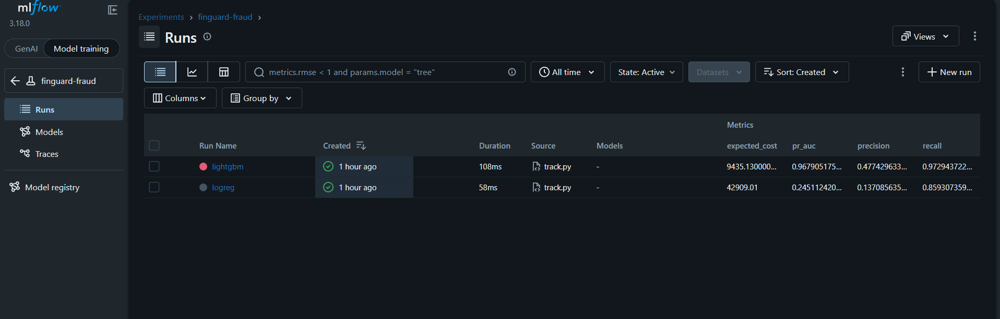
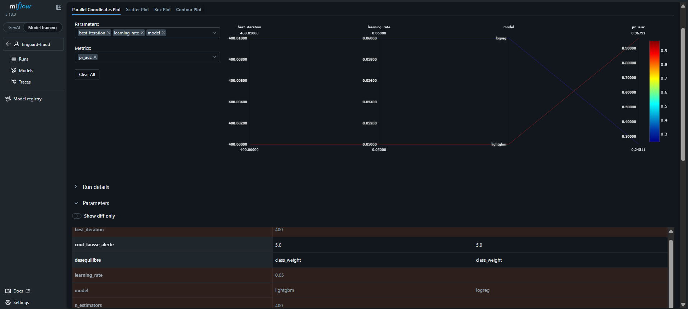
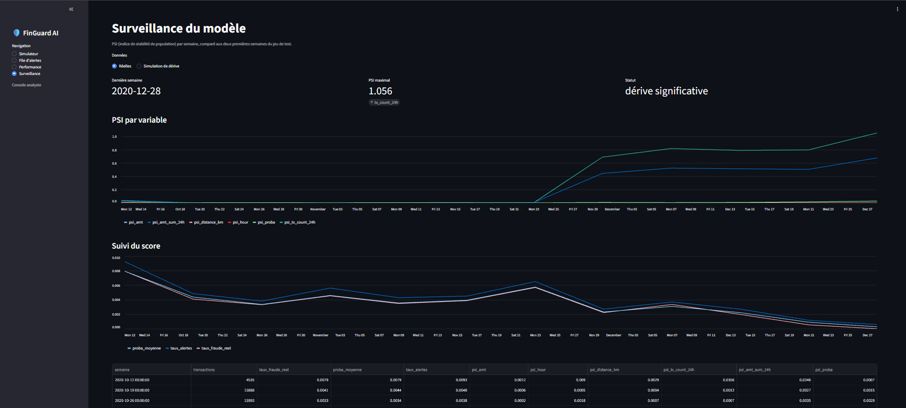
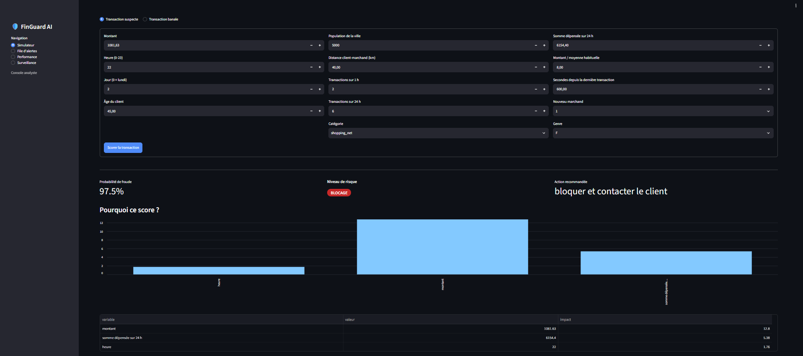

# FinGuard AI : détection de fraude aux paiements

Système de détection de fraude sur transactions par carte bancaire : modèle LightGBM, scoring calibré en quatre niveaux de risque, explication de chaque alerte, API FastAPI conteneurisée et déployée sur Google Cloud Run.

> **Données synthétiques.** Les résultats ci-dessous viennent d'un jeu de données simulé (Sparkov, Kaggle), où les fraudes suivent des schémas plus nets que dans la réalité. Ils ne se transposent pas tels quels à une vraie banque.

## Le problème

Moins de 1 % des transactions sont frauduleuses. Un modèle qui répondrait toujours « pas de fraude » aurait plus de 99 % d'exactitude tout en étant inutile. Le projet est donc évalué avec la PR-AUC, le rappel, la précision et surtout un **coût financier** : une fraude manquée coûte son montant, une fausse alerte coûte 5 € (hypothèse).

## Résultats (période de test, la plus récente)

| | Régression logistique | LightGBM |
|---|---|---|
| PR-AUC | 0,245 | **0,968** |
| Rappel | 85,9 % | **97,3 %** |
| Précision | 13,7 % | **47,7 %** |
| Coût attendu | 42 909 € | **9 435 €** |

Sans modèle, les fraudes de la période test représentent **483 346 €** de pertes. Avec LightGBM, le coût simulé est de 9 435 €.

### Scoring calibré en niveaux de risque

La calibration isotonique ramène la probabilité moyenne prédite de 0,50 % à 0,34 %, pour un taux de fraude réel de 0,33 % (score de Brier divisé par trois : 0,00102 à 0,00035).

| Niveau | Probabilité | Transactions | Fraudes | Taux de fraude |
|---|---|---|---|---|
| Faible | moins de 5 % | 276 759 | 42 | 0,02 % |
| Moyen | 5 à 30 % | 167 | 21 | 12,6 % |
| Élevé | 30 à 80 % | 123 | 64 | 52,0 % |
| Blocage | 80 % et plus | 810 | 797 | 98,4 % |

Le niveau « blocage » capte 797 des 924 fraudes. Il reste 42 fraudes dans le niveau « faible » (environ 10 900 €) : c'est le risque résiduel.

## Méthodologie

- **Split temporel** 70 / 15 / 15 : jamais de découpage aléatoire. Le seuil est choisi sur la validation et évalué sur le test.
- **Pas de fuite de données** : les variables comportementales n'utilisent que le passé strict de la transaction. Un test automatique le vérifie.
- **Variables comportementales** : nombre de transactions sur 1 h et 24 h, somme dépensée sur 24 h, écart au montant moyen habituel du client, temps depuis la dernière transaction, nouveau marchand, distance client-marchand, heure, catégorie.
- **Déséquilibre** géré par pondération des classes, sans SMOTE.
- **Explicabilité** : contributions de type SHAP calculées par LightGBM (`pred_contrib`), traduites en raisons lisibles.

## API

~~~
POST /score
~~~

Exemple de réponse pour une transaction de 1 081,63 € après 6 154 € dépensés sur 24 h :

~~~json
{
  "probabilite_fraude": 0.9754,
  "niveau": "blocage",
  "action": "bloquer et contacter le client",
  "raisons": [
    {"variable": "montant", "valeur": 1081.63, "impact": 12.8},
    {"variable": "somme dépensée sur 24 h", "valeur": 6154.4, "impact": 5.38},
    {"variable": "heure", "valeur": 22, "impact": 1.76}
  ]
}
~~~

L'API valide les entrées (Pydantic) et renvoie une erreur 422 pour un montant négatif ou une catégorie inconnue. `GET /health` sert au contrôle de santé.

## Architecture

~~~
Données CSV -> features -> LightGBM -> calibration -> niveaux de risque
                                                        |
                              FastAPI -> Docker -> Artifact Registry -> Cloud Run
~~~

Le service Cloud Run est privé, sans instance au repos (min 0, max 2), pour maîtriser le coût.

## Lancer le projet

~~~
make install
# placer fraudTrain.csv et fraudTest.csv dans data/raw/
PYTHONPATH=src python -m finguard.train
PYTHONPATH=src python -m finguard.explain
PYTHONPATH=src pytest -q
PYTHONPATH=src uvicorn finguard.api:app --port 8080
~~~

## Structure

| Fichier | Rôle |
|---|---|
| `src/finguard/features.py` | Variables comportementales sans fuite |
| `src/finguard/split.py` | Découpage chronologique |
| `src/finguard/train.py` | Entraînement, comparaison, seuil au coût |
| `src/finguard/explain.py` | Calibration, niveaux de risque, explications |
| `src/finguard/api.py` | API de scoring |
| `tests/` | Tests anti-fuite et tests de l'API |
| `Dockerfile` | Image de l'API |

## Limites

- Données synthétiques : les performances sont surestimées par rapport à du réel.
- Le coût d'une fausse alerte (5 €) est une hypothèse, pas une mesure.
- Une seule période de test : une validation glissante renforcerait la robustesse.
- L'API reçoit des variables déjà calculées ; l'historique client n'est pas géré en temps réel.
- Pas encore de surveillance du drift ni de réentraînement automatique.

## Feuille de route

- [x] Variables, split temporel, modèles de base
- [x] Calibration, niveaux de risque, explications
- [x] API FastAPI, Docker, tests
- [x] Déploiement Cloud Run
- [x] Console analyste (Streamlit)
- [x] Export des données scorées et tableau de bord Power BI
- [x] MLflow, surveillance du drift (PSI), GitHub Actions

## Suivi des expériences et surveillance

**MLflow** : chaque modèle est enregistré avec ses paramètres, ses métriques et ses fichiers (`python -m finguard.track`, puis `mlflow ui --backend-store-uri sqlite:///mlflow.db`).

**Surveillance du drift** : un PSI hebdomadaire par variable est calculé par rapport aux deux premières semaines (`python -m finguard.monitor`). Une simulation (`--simulate`) augmente les montants de 80 % pour montrer la détection. Sur les données synthétiques utilisées ici, aucune dérive réelle n'est attendue.

## Prochaines étapes
- Evidently pour des rapports de drift plus détaillés
- Terraform pour décrire l'infrastructure GCP
- Réentraînement automatique déclenché par le PSI
